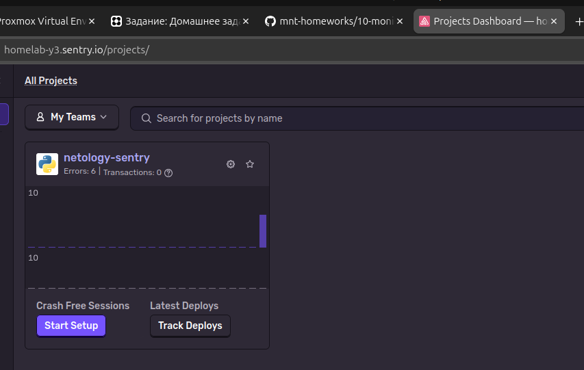
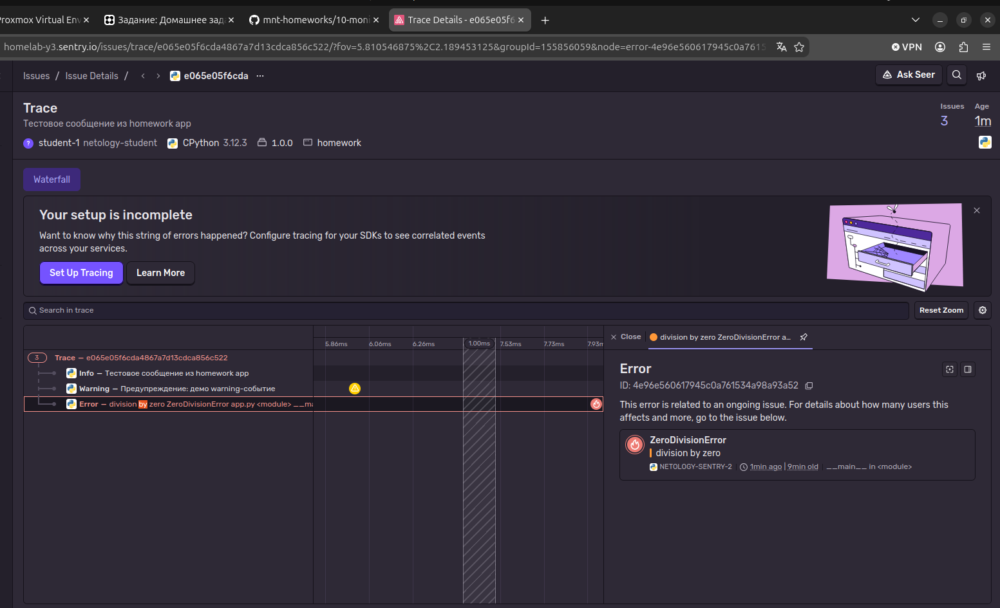
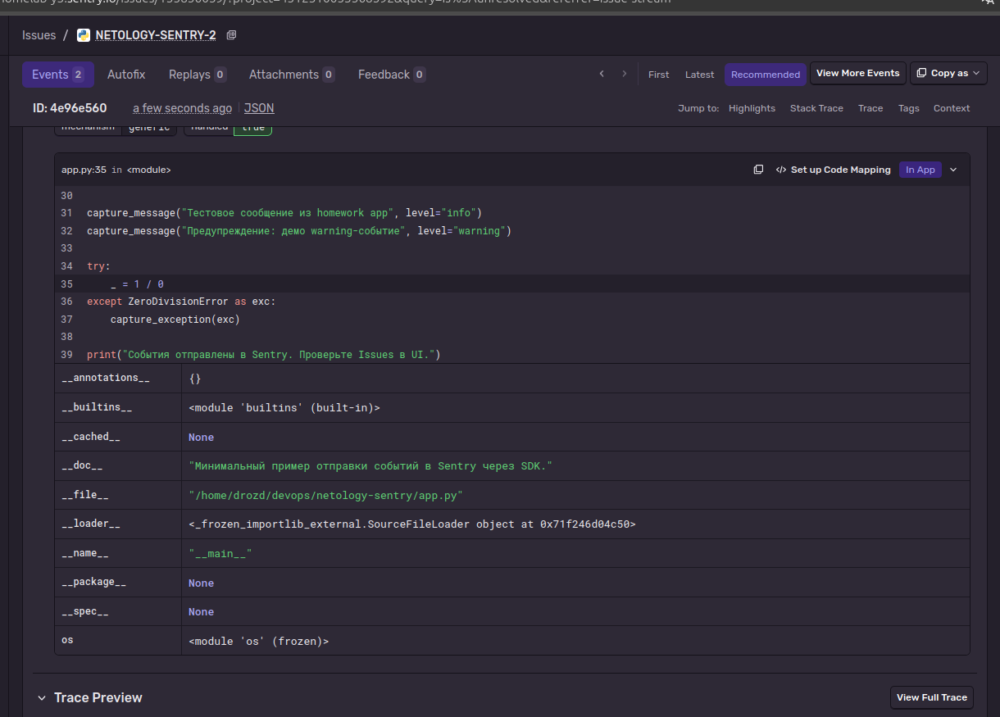
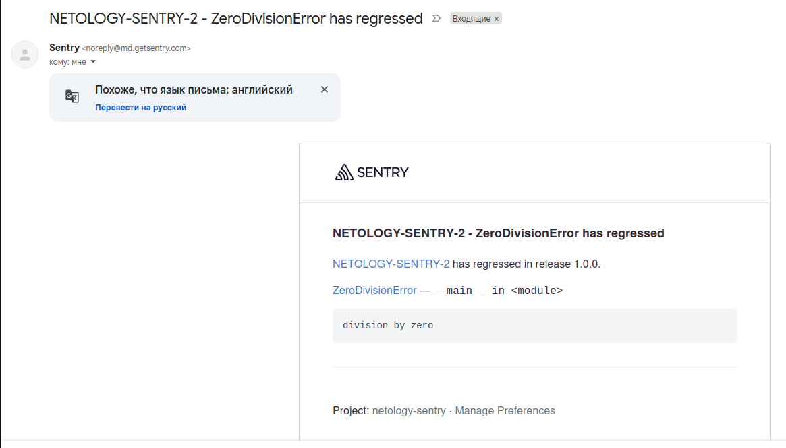

# Домашнее задание: Платформа мониторинга Sentry

Решение к занятию 16 «Платформа мониторинга Sentry».

---

## Задание 1. Free Cloud account

Создан бесплатный аккаунт на [sentry.io](https://sentry.io) через GitHub.

**Скриншот меню Projects:**



---

## Задание 2. Sample event и Resolved

1. Создан Python-проект в Sentry.
2. Сгенерировано тестовое событие через `Generate sample event`.
3. Событие изучено и помечено как `Resolved`.

**Скриншот Stack trace:**



**Список событий после Resolved:**



---

## Задание 3. Правила алёртинга

1. Создано дефолтное правило алёртинга (все поля — `all`).
2. Снова сгенерировано `Generate sample event`.
3. На почту, привязанную к GitHub-аккаунту, пришло оповещение.

**Скриншот тела письма:**



---

## Задание повышенной сложности. Sentry SDK

Небольшое Python-приложение подключает [sentry-sdk](https://docs.sentry.io/platforms/python/) и отправляет несколько тестовых событий.

### Запуск

```bash
python -m venv .venv
source .venv/bin/activate
pip install -r requirements.txt

export SENTRY_DSN="https://<key>@o<org>.ingest.sentry.io/<project>"
python app.py
```

`SENTRY_DSN` берётся в Sentry: **Settings → Projects → [ваш проект] → Client Keys (DSN)**.

### Код

См. [`app.py`](app.py).

### Результат

**Скриншот меню Issues:**


